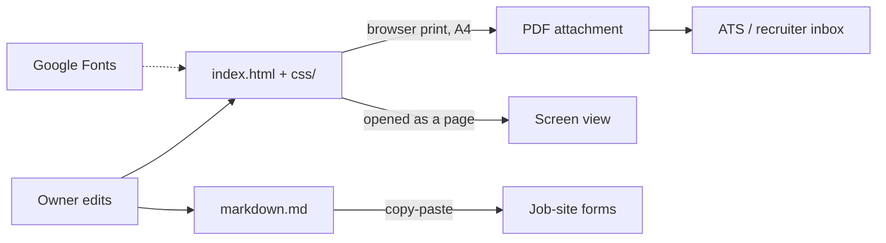

# Architecture: Resume page {#architecture}

Frame: arc42, trimmed to the sections a one-page static site has an analogue for. Dropped as having no analogue: Deployment View beyond "a file on disk" (folded into Context), Architecture Decisions as a separate log (kept inline in Solution Strategy). Tags: `[SOURCED]` / `[INFERRED]` / `[TBD]`, as in `PRD.md`.

## Goals and quality ranking {#quality-goals}

Ranked, because they conflict and the ranking settles trade-offs:

1. **Truthful content.** A claim the owner can't defend costs more than a weaker claim. `[SOURCED]` commits `2ec4f95`, `2916848`.
2. **Print fidelity.** The PDF is what employers receive. `[SOURCED]` `CLAUDE.md`.
3. **ATS readability.** Real text in document order. `[INFERRED]`
4. **Screen polish.** Hover and fade-in are nice to have and are the first thing to give up. `[INFERRED]` they live in a screen-only stylesheet.

## Constraints {#constraints}

- **Public GitHub repo** (`syafiq555/resume`, visibility PUBLIC). Anything committed is world-readable, including docs and `tasks/`. `[SOURCED]` `gh repo view`.
- No build tools, no dependencies, no JavaScript. `[SOURCED]` `CLAUDE.md`, `index.html`.
- Opened from `file://`. Not a Herd site. `[SOURCED]` `CLAUDE.md`.
- Fonts come from Google Fonts over the network; offline, the page falls back to Georgia / system sans. `[SOURCED]` `<link>` in `index.html`, fallbacks in `--font-serif` / `--font-sans`.

## Context and scope {#context}

External partners: Google Fonts (network), the browser's print engine, and whatever ATS reads the PDF.

## Solution strategy {#strategy}

| Decision | Reason |
|---|---|
| One HTML file is the shipped artifact | Print and screen come from the same markup, so they can't drift `[SOURCED]` `CLAUDE.md` |
| Three stylesheets split by media (`resume.css` all, `print.css` print, `screen.css` screen) | Print overrides and screen-only motion never leak into each other `[SOURCED]` `<link media=...>` in `index.html` |
| Styling via CSS custom properties in `:root` | One place for colour and font values `[SOURCED]` `css/resume.css:7-18` |
| BEM-style class names (`block__element`) | Flat specificity, readable markup `[SOURCED]` `index.html` |
| `markdown.md` hand-kept in parity, rebuilt from the HTML | The HTML has been corrected more often; forward-syncing old markdown reintroduced stale claims `[SOURCED]` `CLAUDE.local.md` |

## Building blocks {#building-blocks}

| File | Owns |
|---|---|
| `index.html` | All content and structure. Sections in order: header, summary, experience, side projects, skills, education, certifications |
| `css/resume.css` | Tokens (`:root`), reset, typography, every component, responsive breakpoints (`600px` mobile, `850px` card shadow) |
| `css/print.css` | `10.5pt` base size, tighter spacing, `@page { size: A4; margin: 0 }`, links forced to inherit colour, hover underline hidden |
| `css/screen.css` | Contact-link underline animation, experience hover tint, staggered `fadeInUp`, reduced-motion override |
| `markdown.md` | Same content in markdown for forms. Skills come before experience, and education + certifications are one section |
| `CLAUDE.local.md` (gitignored) | Private job-search context and positioning notes |

## Runtime view {#runtime}

**Print to PDF (the flow that matters):** browser loads `index.html` → applies `resume.css` → applies `print.css` (media print) and skips `screen.css` → root font drops to `10.5pt` so every `rem` shrinks with it → `@page` sets A4 with no margin, the `0.4in 0.55in` padding on `.resume__inner` becomes the visible margin → `page-break-inside: avoid` keeps each experience entry on one page → Save as PDF.

Consequence: a size written in `rem` in `resume.css` scales automatically in print; a size written in `px` does not. `[SOURCED]` reading of the stylesheets.

**Screen load:** `resume.css` + `screen.css` → sections fade in with a stagger by `nth-of-type` (1 to 5) → `prefers-reduced-motion` collapses all animation to near zero.

## Crosscutting concepts {#crosscutting}

- **Bullets are CSS, not text.** List markers come from `::before { content: "-" }` on `.experience__list li`, `.project-item` and `.certs span`, so they never reach the copied text or markdown. `[SOURCED]` `css/resume.css:237,265,363`.
- **Emphasis convention.** `<strong>` marks the system name or the measurable outcome in a bullet; inside `.project-item` it renders in the bronze accent. `[SOURCED]`
- **Qualifiers are content.** The skills grid's "Familiar" row carries an inline `<em>(academic + actively upskilling)</em>`. `[SOURCED]`

## Quality requirements {#quality-requirements}

| Requirement | How it's checked |
|---|---|
| Fits 2 A4 pages | Print preview, A4, count pages `[INFERRED]` target |
| No entry split across pages | Print preview `[SOURCED]` `page-break-inside: avoid` |
| HTML and markdown agree | Read both side by side after an edit `[SOURCED]` parity rule |
| No em dash in text | `grep -c "$(printf '\342\200\224')" index.html markdown.md` returns 0 for both `[SOURCED]` |

No automated checks exist. `[SOURCED]` no test or CI files in the repo.

## Risks and technical debt {#risks}

| Item | Detail |
|---|---|
| Raw values outside `:root` | `body` gradient (`#f8f7f5`, `#f0efed`), card shadows, and the hover tint `rgba(139, 115, 85, 0.04)` in `screen.css` (the bronze accent, hard-coded) bypass the tokens |
| Sixth section not animated | `screen.css` staggers `nth-of-type(1)` to `(5)`; Certifications is the sixth section and appears without a fade. Harmless, but a new section would inherit the gap |
| Exported PDF can go stale | `*.pdf` is gitignored; the local `Syafiq-Shamsuddin-Resume.pdf` (04/06/2026) predates the 18/08/2026 content commits. Re-export before sending |
| Formatting drift between HTML and markdown | Small existing differences: CGPA `3.73` vs `3.73/4.00`, `CTFL (Certified Tester)` vs the full name, section grouping. Claims match; wording does not |

## Glossary {#glossary}

| Term | Meaning |
|---|---|
| `--accent` | Near-black `#1a1a1a`. Not the bronze; `CLAUDE.md`'s "Accent `#8b7355`" refers to `--accent-warm` |
| `--accent-warm` | The bronze `#8b7355`: title, company names, project names, hover colour |
| `--ink` / `--ink-secondary` / `--ink-muted` | Text greys, darkest to lightest |
| Honesty rule | Every number and strong verb must be defensible in an interview. See `ARCHITECTURE-ESSENTIALS.md` |
| Parity | `index.html` and `markdown.md` carrying the same claims |
| ATS | Applicant tracking system: software that parses the PDF before a human sees it |
